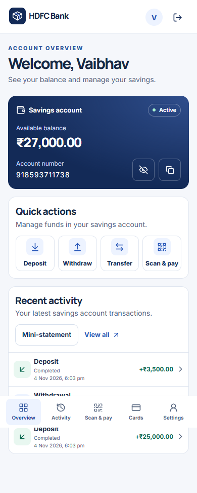
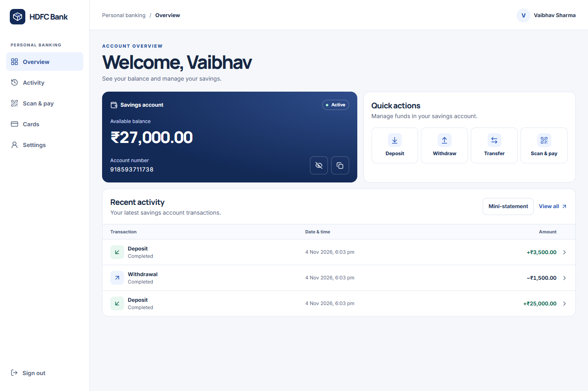
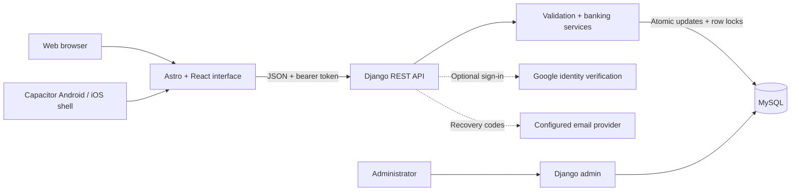
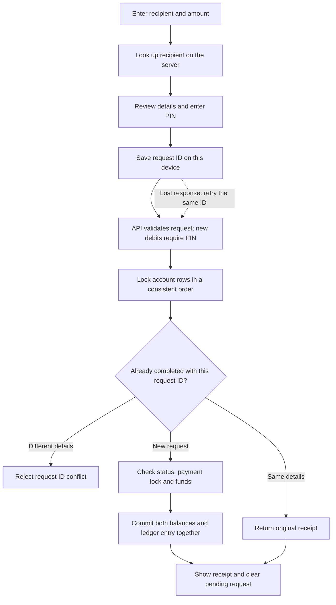

<div align="center">
  

  <h1>HDFC Bank · Student Project</h1>

  <p>A banking simulation built with Django, React and MySQL.</p>

  Manage an account, move funds and follow your activity across the web and mobile.

  [Open the website](https://hdfc-bank-web.onrender.com) · [Mobile releases](https://github.com/Vaibhavsh0120/HDFC-Bank/releases) · [LiveContainer source](https://raw.githubusercontent.com/Vaibhavsh0120/HDFC-Bank/main/apps.json) · [Release notes](CHANGELOG.md) · [Trainer study guide](docs/PROJECT-STUDY-GUIDE.md)
</div>

---

> HDFC Bank is an independent student project. Accounts and funds are fictional, and this project is not affiliated with the real HDFC Bank.

## What you can demonstrate

| Area | Features |
| --- | --- |
| **Personal account** | Register, sign in and receive a savings account with a unique account number. |
| **Everyday transactions** | Deposit, withdraw or transfer to another registered account after reviewing the details. |
| **Activity and statements** | Search and filter transactions, inspect receipts and open a mini-statement. |
| **Administration** | Review customers, accounts and transactions, and manage account status through Django admin. |
| **Scan & pay** | Scan with the native camera or web camera, upload a QR image, or enter an account number. Receive QR codes support an optional amount and note, and can be saved or shared. |
| **Profile & settings** | Edit name, email, phone and address; manage a nominee, saved recipients, outgoing-payment lock and incoming alerts. |
| **Security and recovery** | Optional device unlock in the native app using Face ID, fingerprint or the phone's screen lock; transaction PIN and email recovery; saved sessions for up to 30 days. One eye button hides or reveals the balance and account number. |
| **Cards and support** | Choose VISA, RuPay or Mastercard for a numeric demo card; reveal/hide its details, freeze/unfreeze or replace it; save receipts, export statements, and track support requests. |

<p align="center">
  
  
</p>

## Architecture



| Layer | Technology |
| --- | --- |
| Interface | Astro 7, React 19, TypeScript, Tailwind CSS 4 |
| API | Python 3.12, Django 5.2, Django REST Framework 3.18 |
| Data | MySQL 8, Django ORM and versioned migrations |
| Mobile | Capacitor 7; shared interface and API |
| Hosting | Render frontend/API services; Aiven MySQL |

See [Services and their purpose](docs/SERVICES.md) for the free hosting/database plans, Google sign-in, Brevo recovery emails, GitHub releases, LiveContainer updates and environment ownership.

## How a transfer works



The backend enforces these rules even if someone bypasses the interface. Decimal arithmetic handles money; database constraints reject negative balances and invalid entries. A completed request can be replayed without moving funds again. The [study guide](docs/PROJECT-STUDY-GUIDE.md) explains the models, algorithms, SQL and request flow.

## Run a local demo

Requires **Python 3.12** and **Node.js 22.23.4+**. From the repository root in PowerShell:

```powershell
py -3.12 -m venv .venv
.\.venv\Scripts\python -m pip install --upgrade pip
.\.venv\Scripts\python -m pip install -r backend\requirements-dev.txt
.\.venv\Scripts\python backend\manage.py migrate --settings=config.demo_settings
.\.venv\Scripts\python backend\manage.py runserver 127.0.0.1:8011 --settings=config.demo_settings --noreload
```

In a second terminal:

```powershell
cd frontend
npm ci
$env:PUBLIC_API_URL = "http://127.0.0.1:8011"
npm run dev -- --host 127.0.0.1 --port 4322
```

Open [localhost:4322](http://127.0.0.1:4322/), register two fictional users, deposit demo funds and transfer to the recipient. Use separate browser profiles or an incognito window for the second account.

This preview ignores hosted database credentials and uses `backend/demo.sqlite3`. Recovery emails are saved under ignored `artifacts/emails/`. It is intended for sequential walkthroughs; use MySQL to test concurrent payments. On Linux/macOS, use `python3` and `.venv/bin/python`; mysqlclient may require your OS's MySQL development libraries.

## Mobile app and LiveContainer

Add the [HDFC Bank source URL](https://raw.githubusercontent.com/Vaibhavsh0120/HDFC-Bank/main/apps.json) in LiveContainer's source manager. It lists published iOS IPAs and their release notes. Publishing an iOS or combined build through **Actions → Mobile release** automatically refreshes the same source URL; Android-only and unpublished builds do not change its iOS version. Refresh the source in LiveContainer to see updates. This updates the catalog; it does not silently install apps on your phone.

After the first successful native app login reaches the dashboard, choose **Enable device unlock** or **Not now**. Change this later under **Settings → Security → Device unlock**. Enabled sessions lock when the app goes into the background and at the next cold launch. Authentication uses the phone's system prompt, including its passcode/password fallback. Logout disables device unlock; later logins can enable it in Security without repeating the first-time offer. No app login PIN is created. The website has no device-unlock prompt or setting; the existing transaction PIN still protects payments and card changes. Since 1.5.1 the dashboard balance and account number start visible; card details still start masked.

For **MySQL, devices on the same Wi-Fi, administrator creation, environment variables, hosting and mobile builds**, see [Setup and operations](docs/SETUP.md). Test settings and their fast password hashes must never be deployed.

## Verify the project

```powershell
.\.venv\Scripts\python backend\manage.py test banking --settings=config.test_settings
cd frontend
npm run check
npm test
npm run build
npm audit
```

SQLite runs the isolated functional suite and skips two concurrency tests. The full **54-test suite passed on MySQL 8.0** during the 4 November 2026 review, including simultaneous withdrawals and duplicate-request retries. See [the release review](docs/RELEASE-REVIEW.md) for fixed findings, evidence and remaining external checks.

The [verification workflow](.github/workflows/verify.yml) runs MySQL tests, schema checks, dependency audits and the frontend build. The [mobile workflow](.github/workflows/mobile-release.yml) requires verification before packaging.

## Documentation

| Start here | Contents |
| --- | --- |
| [Trainer study guide](docs/PROJECT-STUDY-GUIDE.md) | One-minute explanation, ER diagram, transfer sequence, Python/OOP, SQL and viva questions. |
| [Setup and operations](docs/SETUP.md) | Local MySQL, LAN devices, environment, deployment, email and mobile releases. |
| [Release review](docs/RELEASE-REVIEW.md) | Findings, fixes, evidence and remaining release checks. |
| [Customer-flow audit](docs/CUSTOMER-FLOW-AUDIT.md) | Customer journeys, browser reproduction and device-test boundaries. |
| [Release notes](CHANGELOG.md) | Changes in every published version and 1.5.0. |

```text
backend/             Django API, domain services, migrations and tests
frontend/            Astro/React interface, assets and Capacitor tooling
docs/                Setup, reviewer guide and verification evidence
scripts/             Local network helpers and browser smoke check
.github/workflows/   Verification and manual mobile packaging
render.yaml          Frontend and API hosting configuration
```

## Demonstration boundaries

- Fictional funds stay inside this project's database. There is no external UPI, real-money payment network, merchant card processing or regulated KYC.
- Email/password registration and contact edits do not verify email ownership. Google identities are not automatically linked to existing password accounts.
- Hosted recovery needs a configured sender. Local email tests do not prove inbox delivery.
- The maintainer confirmed working Face ID on their iPhone after 1.5.1. Android device authentication, camera scanning, native file sharing and Google sign-in still need target-device checks. iOS packages are unsigned and require a compatible signing or LiveContainer setup. LiveContainer behavior depends on its host and device configuration.
- The team must provide its actual contributions and match the trainer's rubric. The project has one Django domain app and no custom banking many-to-many model.

## Team

- Vaibhav Sharma
- Aashi Agarwal
- Yashika Pachori
- Arsh Khan

Found an issue? [Open a GitHub issue](https://github.com/Vaibhavsh0120/HDFC-Bank/issues) with reproduction steps, without passwords, PINs, tokens or recovery codes.
