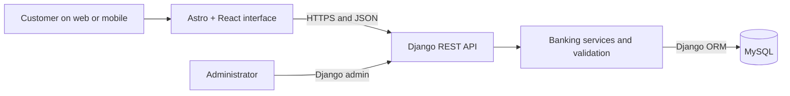
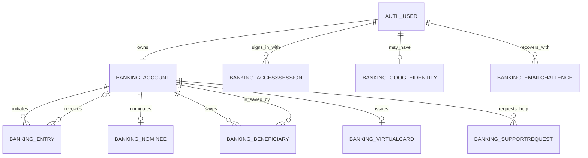
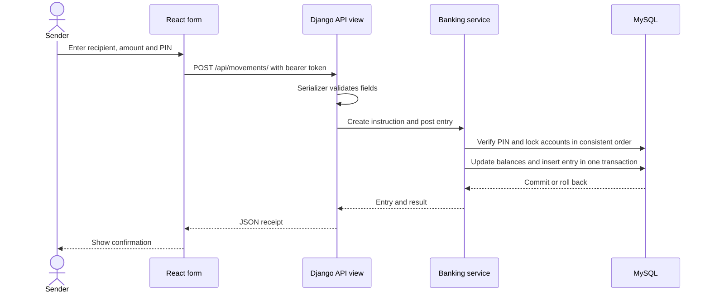

# Project study guide

This guide is for explaining the project in a college review. Start with the one-minute explanation, then follow a transfer through Django and MySQL. Read the linked source files alongside it.

## Explain it in one minute

This project is a personal banking application for learning. A customer creates an account, signs in, views their balance and activity, and can deposit, withdraw or transfer fictional funds to another project account. A React interface sends requests to a Django REST API. Django validates each request, applies the banking rules and reads or writes a MySQL database. The same API supports the website and the mobile app. An administrator manages records using Django admin.

There is no connection to a real bank or payment network. A transfer only moves balances between accounts in the same project database.



## The important folders

| Place | What to explain |
| --- | --- |
| [`backend/config/urls.py`](../backend/config/urls.py) | Connects a URL to a view function. |
| [`backend/banking/views.py`](../backend/banking/views.py) | Receives API requests and returns HTTP responses. |
| [`backend/banking/serializers.py`](../backend/banking/serializers.py) | Checks and converts incoming data and formats responses. |
| [`backend/banking/services.py`](../backend/banking/services.py) | Holds transaction rules and database transaction logic. |
| [`backend/banking/models.py`](../backend/banking/models.py) | Defines database models and constraints. |
| [`backend/banking/authentication.py`](../backend/banking/authentication.py) | Issues and checks bearer sessions. |
| [`backend/banking/pin.py`](../backend/banking/pin.py) | Stores hashed PINs and limits incorrect attempts. |
| [`backend/banking/structures.py`](../backend/banking/structures.py) | Contains the custom circular buffer and merge algorithm. |
| [`backend/banking/migrations/`](../backend/banking/migrations/) | Records how the database schema changes over time. |
| [`frontend/src/components/`](../frontend/src/components/) | React screens and forms. |
| [`scripts/`](../scripts/) | Starts and stops the Windows local-network setup. |

The Django project is `config`; the application currently has one domain app, `banking`. The separate frontend is Astro with React components, not Django templates.

## MySQL tables and relationships

The names below are Django's default table names. Migrations also create Django's own admin, permission, group and content-type tables.



| Table | Key information |
| --- | --- |
| `auth_user` | Django user identity and hashed password. Staff and superuser flags control administrator access. |
| `banking_account` | One account per user, account number, balance, status, hashed PIN and lock information. `owner_id` connects it to `auth_user`. |
| `banking_entry` | Each deposit, withdrawal or transfer. `initiator_id` and optional `recipient_id` point to accounts. A request ID prevents the same instruction being applied twice. |
| `banking_accesssession` | Hash of a bearer token, its user and expiry time. The raw token is not stored in this table. |
| `banking_googleidentity` | A hashed Google subject and its linked user. |
| `banking_emailchallenge` | Hashed password/PIN recovery codes, purpose, expiry, email snapshot and failed attempts. |
| `banking_nominee` | Optional one-to-one nominee record, with guardian details for minors. |
| `banking_beneficiary` | Saved sender/recipient pair and nickname. The pair is unique. |
| `banking_virtualcard` | Optional one-to-one demonstration card identifier and freeze status. |
| `banking_supportrequest` | Account-scoped issue, reference, status and administrator response. |

**One-to-one** means an account belongs to one user, and a user has one account. **Foreign key** means a column points to another table's row. An entry has an initiator and, for a transfer, a recipient. Django's built-in user/group permission tables use many-to-many relationships; the custom banking models do not currently define their own many-to-many field.

Money uses `DecimalField`, so amounts use decimal arithmetic instead of floating point. Constraints reject negative balances, non-positive entry amounts and invalid transfer participants. Database constraints protect the data even if a caller bypasses a form.

## Follow a transfer from click to database



1. The React form validates the input and asks the API to look up the recipient before confirmation.
2. The bearer token identifies the sender. `InstructionSerializer` checks the transaction type, amount, request ID, recipient and PIN format.
3. `post_entry` verifies the PIN for transfers and withdrawals. PIN failures are saved, and five incorrect attempts cause a 15-minute lock.
4. `_post_entry` starts an atomic database transaction and locks the relevant account rows in a consistent order. It checks balances and account status, updates both balances, and creates the entry. If an error occurs inside the transaction, its balance changes and entry are rolled back together.
5. A unique `(initiator, request_id)` constraint and the service's comparison make a retry of the same instruction return the existing receipt. A different instruction using the same ID is rejected.
6. The recipient's open app polls the updates endpoint approximately every four seconds. New incoming entries show a notice and update the displayed balance. This is polling, not a WebSocket or a guaranteed background push notification.

Read `movement` in `views.py`, `InstructionSerializer`, and `post_entry` / `_post_entry` in `services.py` in that order. The initial PIN verification and the money transaction are separate database transactions; the PIN failure count therefore survives a rejected attempt.

## API examples

All paths below are relative to the API origin. Protected requests use `Authorization: Bearer <token>`; never share a real token or PIN in a screenshot or report.

| Method and path | What it does |
| --- | --- |
| `POST /api/auth/register/` | Creates a user and account. |
| `POST /api/auth/login/` | Checks credentials and returns a session. |
| `POST /api/auth/google/` | Verifies a Google identity token with the configured web client ID. |
| `GET /api/dashboard/` | Returns the signed-in user's account summary. |
| `GET, POST, PATCH /api/security/pin/` | Reads PIN status, creates a PIN or changes it. |
| `POST /api/recipient/` | Looks up an eligible recipient using a JSON `number` field. |
| `POST /api/movements/` | Deposits, withdraws or transfers an amount. |
| `GET /api/history/` | Returns account activity with supported search/filter options. |
| `GET /api/activity/updates/` | Polls for incoming transfers using a cursor. |
| `POST /api/auth/logout/` | Revokes the current bearer session. |
| `POST /api/auth/password/change/` | Changes the password, keeps this session and revokes other bearer sessions and pending password-reset codes. |
| `POST /api/auth/password/reset/request/` | Requests an emailed recovery code without confirming whether an account exists. |
| `POST /api/auth/password/reset/confirm/` | Consumes a valid code, changes the password and revokes all bearer sessions. |
| `POST /api/security/pin/reset/request/` | Emails a PIN recovery code to the signed-in customer's address. |
| `POST /api/security/pin/reset/confirm/` | Consumes that code, changes the PIN and clears its attempt lock. |
| `GET, PATCH /api/profile/` | Reads/updates contact details and preferences; lock changes require a PIN checked against the locked row. |
| `GET, POST, DELETE /api/nominee/` | Reads or replaces/removes the account's nominee. Writes require a PIN. |
| `GET, POST, DELETE /api/beneficiaries/` | Lists, saves or removes recipients belonging to this account. |
| `GET, POST, PATCH /api/card/` | Reads, creates or freezes/unfreezes a demo card. Writes require a PIN. |
| `GET, POST /api/support/` | Reads the latest 30 support requests or submits a new request. |

Typical responses include `200` for successful reads, `201` for a new movement, `400` for invalid input, `401` for an invalid session, `403` when a PIN is required, `409` for a conflicting request ID and `429` for a locked PIN or throttling. Inspect the actual endpoint for its precise response. For Postman, first register or sign in, copy your own returned token into the Bearer Token authorization field, then call a protected endpoint.

## SQL practice

Run these **read-only** examples against a local database that contains accounts created through the app. Table data is created by the application; do not run experiments against the hosted database.

```sql
-- Find account owners and balances.
SELECT u.first_name, a.account_number, a.balance
FROM banking_account AS a
JOIN auth_user AS u ON u.id = a.owner_id;

-- Count and total entries by transaction type.
SELECT kind, COUNT(*) AS entry_count, SUM(amount) AS total_amount
FROM banking_entry
GROUP BY kind;

-- See the latest transfers and both account numbers.
SELECT e.created_at, sender.account_number AS sender,
       receiver.account_number AS receiver, e.amount
FROM banking_entry AS e
JOIN banking_account AS sender ON sender.id = e.initiator_id
JOIN banking_account AS receiver ON receiver.id = e.recipient_id
WHERE e.kind = 'transfer'
ORDER BY e.created_at DESC;
```

For `CREATE TABLE` and `INSERT` practice, use a temporary table in a local MySQL session. It is separate from the application's tables and disappears when the session ends.

```sql
CREATE TEMPORARY TABLE practice_amounts (id INT PRIMARY KEY, amount DECIMAL(10,2));
INSERT INTO practice_amounts (id, amount) VALUES (1, 125.50);
SELECT * FROM practice_amounts;
```

Django migrations describe schema changes, and the ORM turns model operations into SQL. `python backend/manage.py sqlmigrate banking 0004` displays the SQL for migration `0004` using the configured database; it does not apply the migration. `migrate` applies pending migrations, so check the database configuration first.

## Python and OOP examples

- **Abstraction:** `Movement` is an abstract base class with a `changes` method. `Deposit`, `Withdrawal` and `Transfer` implement it.
- **Inheritance and polymorphism:** those three classes inherit from `Movement`; the service selects one from `MOVEMENTS` and calls the same method to obtain different balance changes.
- **Encapsulation:** the circular buffer manages its own internal list, position and size through `append` and iteration. Python's underscore names signal internal implementation details.
- **Custom exceptions:** `BankingError` and subclasses such as `InsufficientFunds` and `PinLocked` describe domain failures; the view turns them into JSON errors and HTTP status codes.
- **Data structures and algorithms:** `CircularBuffer` retains a fixed number of recent entries. `merge_ordered` merges two already-sorted streams in linear time, and `mini_statement` uses both. The buffer and merge implementation are in `structures.py`.
- **Other Python features:** the code uses lists, sets, dictionaries, comprehensions, a lambda, decorators such as `@transaction.atomic` and a generator with `yield`. Inspect the source for an example before describing it.

## Questions a trainer may ask

1. **Why use a transaction?** It keeps balance updates and the ledger entry together so a failure cannot commit just part of a transfer.
2. **Why lock account rows?** Concurrent transfers could otherwise read the same balance and both spend it. Locks serialize operations involving the same accounts.
3. **Why sort the lock order?** Taking shared locks in a consistent order reduces the chance of a database deadlock.
4. **Why a request ID?** A network retry can safely ask about the same instruction without repeating its balance change.
5. **Why hash the PIN and token?** The database does not need the original values to verify a PIN or look up an issued bearer token.
6. **What is a migration?** A versioned description of a schema change that Django can apply to the configured database.
7. **How does the recipient see a transfer?** An open screen polls for entries after its last cursor; it does not provide background push notifications.
8. **How do local and hosted data differ?** The local script connects to MySQL on this computer. The deployed API connects to Aiven MySQL. They are separate databases.

## Before the college review

### A seven-minute demonstration

Use the isolated demo in the [README](../README.md#run-a-local-demo), or the local MySQL setup in [Setup and operations](SETUP.md). Use fictional names, email addresses and funds.

| Step | Demonstrate | Expected result |
| --- | --- | --- |
| 1 | Register a sender and a recipient in separate browser profiles. | Two distinct 12-digit account numbers and zero balances. |
| 2 | Deposit INR 1,000 into the sender account. | INR 1,000 balance and a deposit receipt. |
| 3 | Transfer INR 250 using the recipient's number or QR; create a PIN when prompted. | Sender INR 750, recipient INR 250, and one transfer reference visible to both. |
| 4 | Withdraw INR 100; then try to withdraw INR 1,000. | First withdrawal succeeds; second is rejected. Sender remains at INR 650. |
| 5 | Lock outgoing payments in Preferences, then return to Overview. | Withdrawal/transfer controls are disabled; backend requests are also rejected. |
| 6 | Search activity, inspect a receipt and export CSV. | Correct direction, amount, reference and saved file. |
| 7 | Show a support request and the read-only ledger in Django admin. | Administrator can reply/freeze accounts while ledger amounts remain protected. |

For demo administration, run `.\.venv\Scripts\python backend\manage.py createsuperuser --settings=config.demo_settings` from the project root and open `http://127.0.0.1:8011/admin/`. For the MySQL setup, omit the demo settings and use that API's address. These are separate databases.

### Evidence to show

The [release review](RELEASE-REVIEW.md) records the exact automated checks and external limitations. The [browser smoke script](../scripts/ui-smoke.cjs) also simulates a committed withdrawal whose response is lost, reloads the page, and retries the saved request without a second debit.

- Run the local setup and tests in the [README](../README.md), create two local users, and practise a transfer and statement lookup.
- Practise tracing a request through the files listed above and running the read-only SQL queries.
- The team must supply its own real contributions, commit history, pull requests and reviews. Those cannot be generated as a substitute for actual teamwork.
- Check the trainer's requirements against the current code. In particular, this project has one domain Django app and no custom banking many-to-many model; do not claim those requirements are already satisfied.
- A successful build does not prove Google sign-in or QR camera access on a physical device. Test the relevant device and account before presenting those flows.
